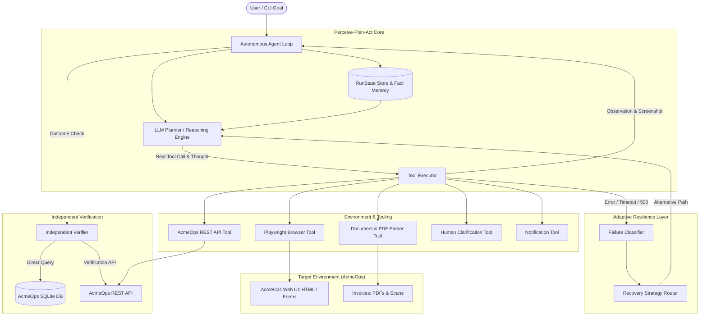

# Design Document: Autonomous AI Task Worker

## Executive Summary
This document specifies the architecture, engineering principles, and operational design of the **Autonomous AI Task Worker** — an agentic system capable of completing end-to-end knowledge and computer operations without step-by-step guidance. The worker accepts high-level natural language goals, dynamically decomposes tasks, perceives multi-modal environments (DOM trees, PDF invoices, HTTP APIs), detects failures, recovers via alternative execution strategies, and performs strict independent verification before claiming success.

---

## 1. System Architecture

### Component Breakdown
1. **Agent Loop (`agent/loop.py`)**: Orchestrates the master lifecycle: Perceive $\rightarrow$ Plan $\rightarrow$ Act $\rightarrow$ Observe $\rightarrow$ Verify.
2. **Planner (`agent/planner.py`)**: Selects tools using structured function/tool-calling. Operates in two complementary modes:
   - **Production LLM Mode**: Calls OpenAI (`gpt-4o`) or Gemini (`gemini-1.5-pro`) using structured tool schemas.
   - **Deterministic Engine Mode**: A state-aware reasoning engine that guarantees reproducible, zero-API-key demonstrations and deterministic CI test suites.
3. **Executor (`agent/executor.py`)**: Dispatches tool calls, captures DOM states, records full-page screenshots, enforces timeouts, and synchronizes memory facts.
4. **Memory (`agent/memory.py`)**: A structured run-state store (`RunState`) tracking goal, subtasks, extracted business facts, full chronological tool history, and clarification questions. Persisted to disk as JSON after every step and rendered as an interactive visual HTML audit trace.
5. **Failure & Recovery Engine (`agent/failure_handler.py`)**: Classifies failures into taxonomies (`UI_CRASH_OR_500`, `ELEMENT_NOT_FOUND`, `AUTH_FAILURE`, `AMBIGUOUS_DATA`, `VERIFICATION_MISMATCH`) and routes execution to adaptive recovery strategies.
6. **Verifier (`agent/verifier.py`)**: Performs independent out-of-band verification by comparing recorded database records against source document facts.
7. **Simulated Company Application ("AcmeOps") (`acme_ops/`)**: A real local FastAPI + SQLite web app featuring session-cookie auth, vendor bills inbox, invoice entry form, deliberate failure modes (deadlock 500 error), duplicate key detection, and a robust REST API.

---

## 2. Why the Loop is Structured This Way

### Rejection of Hardcoded Scripting
Traditional RPA (Robotic Process Automation) relies on brittle, linear step scripts ($A \rightarrow B \rightarrow C$). If step $B$ fails (e.g. a button moves, a worker crashes, or an invoice format changes), the entire script collapses. 

In contrast, this system implements a genuine **Perceive $\rightarrow$ Plan $\rightarrow$ Act $\rightarrow$ Observe $\rightarrow$ Verify** loop:
1. **Perceive**: The agent observes current state from its environment (page URL, DOM summary, file contents, extracted facts).
2. **Plan**: The planner evaluates: *“Given my goal and current observation, what is the single next best action?”*
3. **Act**: The executor runs the tool with validated arguments.
4. **Observe**: The outcome is captured (DOM change, HTTP status, or error trace).
5. **Verify**: The outcome is validated against an independent ground truth.

This architecture enables:
- **Opportunistic Execution**: If the agent is already logged in, it skips the login step.
- **Dynamic De-duplication**: If an invoice is already entered, the agent notices and verifies rather than attempting a duplicate write.
- **Feedback-driven Adaptation**: Observations dictate the next plan rather than an inflexible recipe.

---

## 3. Failure Handling, Adaptive Retries, and Recovery

Autonomous agents must not give up when an action fails, nor should they mindlessly repeat the exact same failing action in an infinite loop.

### Failure Classification Taxonomy
When an action fails, `FailureClassifier` maps the error into a deterministic category:

| Error Symptom | Classification | Adaptive Recovery Strategy |
| :--- | :--- | :--- |
| `500 Internal Server Error`, Database deadlock | `UI_CRASH_OR_500` | **API Fallback**: Switch from failing browser form to authenticated REST API (`POST /api/invoices`). |
| Selector timeout, element hidden/moved | `ELEMENT_NOT_FOUND` | **DOM Re-inspection**: Inspect DOM summary to locate alternative controls or re-navigate. |
| 401 Unauthorized, redirect to `/login` | `AUTH_FAILURE` | **Re-authentication**: Navigate to `/login` and re-authenticate. |
| Multiple documents match query | `AMBIGUOUS_DATA` | **Human Escalation**: Halt execution and prompt human operator for clarification. |
| DB value differs from source document | `VERIFICATION_MISMATCH` | **Re-extraction**: Re-parse original document and reconcile conflicting fields. |

### Bounded Retries with Strategy Switching
- Every failure type maintains an independent retry counter in `RunState.failure_counts`.
- If an action fails once, the system switches execution channels (e.g. Web UI $\rightarrow$ REST API).
- If retries exceed `MAX_RETRIES_PER_FAILURE` (default: 3), the agent safely halts and escalates to a human operator.

---

## 4. Independent Verification: Never Trust Tool Status Alone

A core flaw of naive task workers is "optimistic completion" — assuming that because a button was clicked without a crash, the business transaction succeeded. In enterprise systems, clicks can fail silently (unhandled client-side validation, dropped background workers, database rollback).

### The 3-Step Verification Protocol
1. **Out-of-Band State Check**: The agent queries the database directly (`get_invoice_by_vendor_and_number`) or queries the independent `/api/verify` endpoint.
2. **Strict Multi-Field Ground Truth Comparison**:
   $$\text{Match} = (\text{DB}_{\text{vendor}} == \text{Doc}_{\text{vendor}}) \land (\text{DB}_{\text{inv}} == \text{Doc}_{\text{inv}}) \land (|\text{DB}_{\text{amt}} - \text{Doc}_{\text{amt}}| < 0.01) \land (\text{DB}_{\text{due}} == \text{Doc}_{\text{due}})$$
3. **Cryptographic Evidence Hashing**: If and only if all fields match, the verifier computes a SHA-256 evidence certificate over the database record and marks the invoice as verified in the ERP audit table.

---

## 5. Human-in-the-Loop Clarification Architecture

When facing ambiguity, an autonomous agent should never guess:
- In Task 3, two invoices match "CloudScale Solutions" (`INV-3011` for \$1,250 and `INV-3025` for \$3,450).
- The planner detects that proceeding without guidance risks entering the wrong financial commitment.
- The agent calls `ask_human_clarification`, setting `status="AWAITING_CLARIFICATION"`.
- The CLI renders an interactive prompt with explicit choices.
- The operator's response is committed to `RunState.clarification_answer`, enabling the agent to resume execution safely.

---

## 6. Known Limitations and Trade-offs

1. **Local Network / Port Scoping**: Playwright runs against `127.0.0.1:8000`. In multi-tenant cloud environments, mock apps would run in isolated Docker containers with ephemeral DNS.
2. **OCR for Highly Distorted Images**: The current image parser handles scanned templates and receipts using layout heuristics and metadata. For degraded physical scans (heavy skew, coffee stains), integrating Tesseract or a vision model (e.g. Gemini Vision API) would be required.
3. **Single Browser Tab Scope**: The prototype maintains a single active page context. Highly complex enterprise ERPs opening multi-window popups would require multi-tab page tracking.

---

## 7. Technical Stack and External Services

- **Language/runtime:** Python 3.10 or newer.
- **Web app/API:** FastAPI, Uvicorn, Jinja2 templates, Pydantic, and SQLite.
- **Browser automation:** Playwright with local Chromium.
- **Document handling:** PyMuPDF for PDF text extraction and Pillow for image handling. Extraction uses local text/layout heuristics rather than general-purpose OCR.
- **Agent/model integration:** The OpenAI Python SDK and tool calling, using OpenAI models (default `gpt-4o`) or Google's OpenAI-compatible Gemini API (default `gemini-1.5-pro`). The deterministic planner needs no model or API key.
- **Supporting libraries:** HTTPX, Rich, `python-dotenv`, `python-multipart`, and pytest.
- **External services:** None are required for local deterministic runs. Using OpenAI or Gemini requires network access and sends planner prompts and task context to the configured provider.

## 8. Key Design Decisions and Assumptions

### Design Decisions

- Keep a deterministic planner so demos and tests do not depend on external model availability or credentials.
- Use a local FastAPI + SQLite AcmeOps application as a reproducible ERP-like target rather than requiring access to a real enterprise system.
- Exercise the real browser flow with Playwright and use an authenticated REST API fallback for the deliberately injected UI failure.
- Independently verify persisted invoice facts instead of trusting a successful tool response.
- Ask a human to resolve ambiguous invoice matches rather than selecting a financial record without guidance.
- Persist structured JSON and HTML execution traces so actions and outcomes can be inspected.

### Assumptions

- The target is the included local AcmeOps demo, not a production accounting or ERP system.
- Invoice files are available in the repository's `documents/` directory and follow formats the included parser heuristics can handle.
- Chromium can run locally, and the configured host and port (`127.0.0.1:8000` by default) are available.
- Sample credentials and the default secret key are for local demonstration only and must be changed before any non-demo deployment.
- The deterministic planner covers the included demo flows; it is not a general-purpose substitute for model-based planning.
